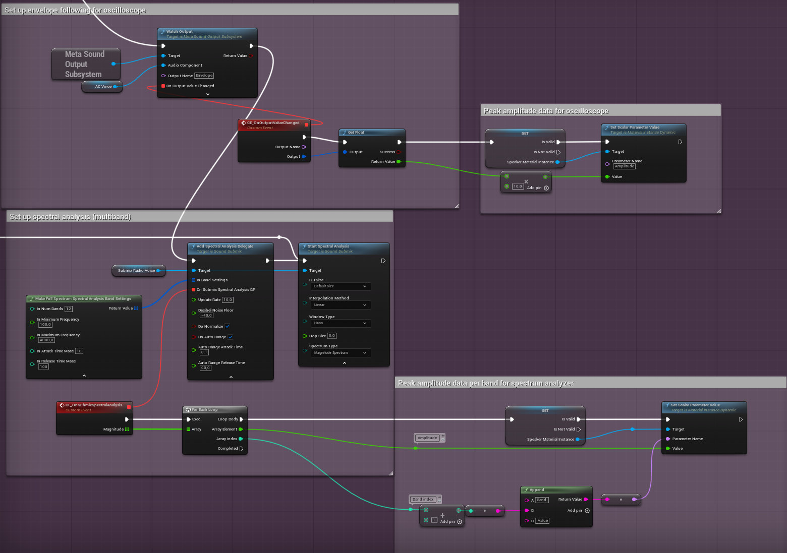
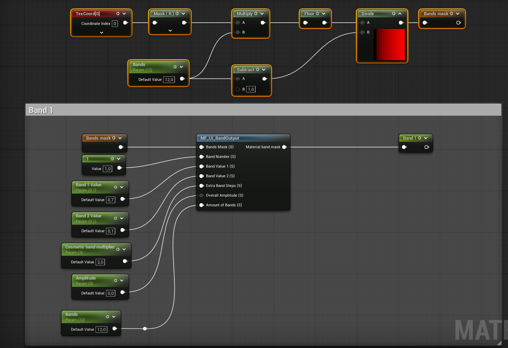
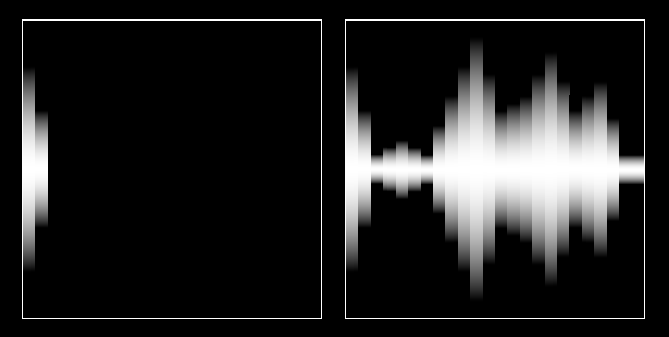
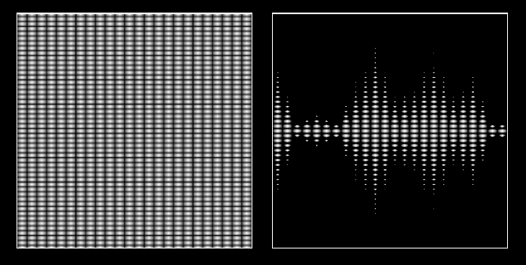
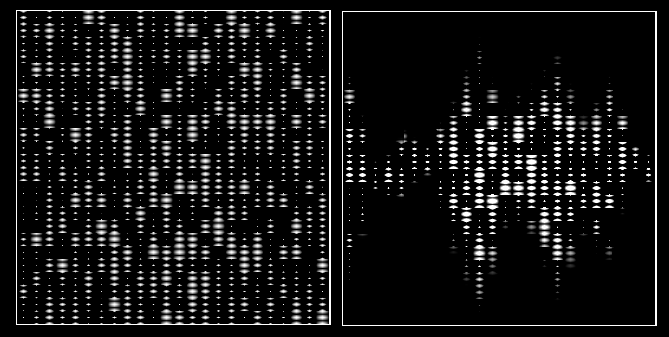
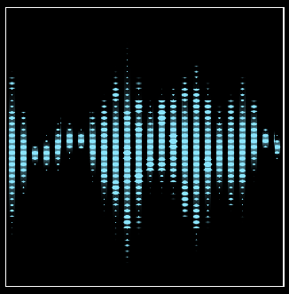
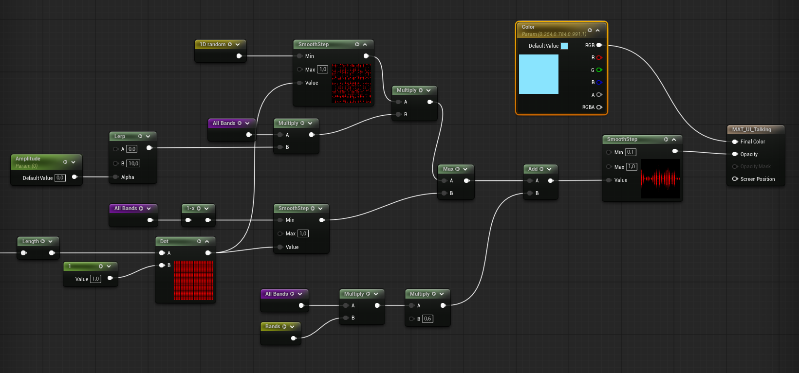

# Overview

**End of Abyss** is a twin-stick shooter metroidvania, with a sci-fi horror theme to it. It was released on **October 1th 2026**.

I joined the project as an intern in November 2023 when the game was still in pre-alpha. During my time at the company, both as intern and employee, I have gotten to work with an incredible small team all the way to release and beyond.

My responsiblities during the project has mainly been implementing the UI and working on systems that the UI depends upon, such as the scanning/map icon system. But as one of the 2-3 programmers we have been on this project I have also had to work on quite a few different things.

**Continue to read below for a deeper dive!**

---

 

# The UI

## Implementation

 

## The Map
 

## Materials

<figure class="float-right">
  <a href="/assets/projectstuff/EndOfAbyss/CRT-web.mp4" target="_blank" rel="noopener noreferrer">
    <video class="bracket" muted loop playsinline autoplay preload="metadata">
        <source src="/assets/projectstuff/EndOfAbyss/CRT-web.mp4" type="video/mp4">
    </video>
  </a>
  <figcaption>CRT effect in the map menu. [click to see in full]</figcaption>
</figure>

One of my favourite things to work on is UI materials and in this project I have gotten the chance to improve my material-making skills quite a lot. Materials have been quite a central part in bringing our concepts to life. Everything from simple radial progression bars to the main CRT-like overlay has helped in giving the games UI the feeling we were striving for.

 

A deep-dive into the pager material

<video class="bracket" muted loop playsinline autoplay preload="metadata">
  <source src="/assets/projectstuff/EndOfAbyss/Pager-web.mp4" type="video/mp4">
</video>

The pager material was an interesting challenge since it was made near the end of the project with a lot of **time constraints**. It also needed me to **sync it to the audio** that is being played when the NPCs are calling, something I hadn't done before.

 

## The Setup

<figure class="float-right">
    
    <figcaption> Blueprint setup</figcaption>
</figure>

<figure class="float-right">
    
    <figcaption> Band 1 in material </figcaption>
</figure>

<figure class="float-right">
    
  <figcaption> Band 1's output / All band outputs </figcaption>
</figure>

To start of we of course had to tie it to the actual played audio, this I got help with from our audio guy, Lilja. So whilst he fixed the setup with the submixes and audio-related things I made sure to connect it to the material.

The next thing was to tie the respective frequency values to their "band"/column, but something I realized quite quickly is that it didn't look quite right with just 12 proper bands. So my solution was to insert an extra column with a lerped fake value in between each actual value creating the illusion of reading more frequencies than we are.

There is also a sine wave offset that is based on the overall amplitude of the entire audio, this gives more movement and life to the material.

The band setup you see in the pic is just for "Band 1" and has been copy-pasted for the other 12 frequency reads. I am not super happy with this setup and would've hoped it could've been more automated. Due to the time constraints this was the solution I ended up with since I felt like I couldn't spend time researching a better way of setting up the multiple bands.

The bands are then maxed together to create the full output.

**At this point we have a fully functioning audio visualiser, but it isn't very appealing to look at**

 

## The Cosmetic Side

<figure class="float-right">
    
  <figcaption> Dotted Pattern / Smooth-step effect </figcaption>
</figure>

At this point it is time to **spruce up** the material. I was working after a reference video, unfortunately I don't have the reference available.

The first order of buisness was to create a sort of dithered/cell-like effect. This was achived by creating rows and columns that was later multiplied together to create a dotted pattern.

When combining this pattern with the previous output from all the frequency bands in a smooth-step node it creates a tapered pattern.

<figure class="float-right">
    
  <figcaption> Noise Pattern / Combined with volume </figcaption>
</figure>

<figure class="float-right">
    
  <figcaption> FinalOutput </figcaption>
</figure>

This already looks good, but the reference video had a bit more noise and randomness in it. So to achieve that I used the dotted pattern from before but instead combined it with a randomly genereated noise. The noise was created with half the amount of rows to create a broken effect on some of the dots. Combining this with the amplitude and frequency bands make the noise show up more when the volume is stronger.

The frequency values are then added back in to create the final result.

<figure>
    
    <figcaption> Final combination of everything in graph </figcaption>
</figure>

 

## Custom slate widgets
 

## Custom UI navigation system
 

---

 

# Other Stuff

## Tools

One of the most useful things I have gotten to learn during this project 

 

## Platform certification and compliance
 

## Suit Mods
 

