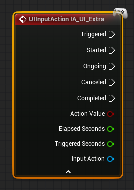

# Overview

The goal of this plugin was mainly to create a **UI navigation** system that is more reliant on **Unreal's Enhanced Input** system. It is both derivative of Unreal's own UI plugin Common UI and the navigation system we used for **End of Abyss**. 

During my time developing UI in UE5, both at school and professionaly, I have felt like Epic's solutions for controller/keyboard navigation in UI has been frustrating to work with. Both by hindering the fine control over the focus, but also by having a very clunky way of handling input that is not pure focus navigation. The solution that my lead started on and I later further developed on for End of Abyss had better support for controllers, but instead was very limited when it came time to handle keyboard and mouse. So my goal is to take the best from both worlds and make it into a plugin I personally want to develop UI in. **Having good support for Blueprints is also very important for this**

Aside from the navigation the goal is also to add quality of life features to the aesthetic side of UI development as well. For example a variable color palette for UMG images.

**This plugin is still under development.**

---

# Navigation

Under here I will discuss some of the work I have made to improve upon the UI navigation. Currently I am using my own focus system after disabling Unreals, though I am not quite happy with this and will most likely update it to try and use Unreal's built in focus system.

My UI manager subsystem contains my favourite lines of code however:
<figcaption> Nuking the native navigation </figcaption>

```cpp
	if (ensure(FSlateApplication::IsInitialized()))
	{
		InputListener = MakeShared<FUNCUIInputListener>();
		FSlateApplication::Get().RegisterInputPreProcessor(InputListener, 0);
		
		TSharedRef<FNavigationConfig> navigation_config = MakeShared<FNavigationConfig>();
		navigation_config->bTabNavigation = false;
		navigation_config->bKeyNavigation = false;
		navigation_config->bAnalogNavigation = false;
		FSlateApplication::Get().SetNavigationConfig(navigation_config);
	}
```


## The Enhanced Input K2 nodes

<figure class="float-right twentyWidth" >
     
    <figcaption> UI Input Action Node</figcaption>
</figure>

One of the first things I wanted to get going with this plugin was to make Enhanced Input nodes more functional with UI/UMG. Whilst in standard UE5 you can of course already add the Enhanced Input nodes, they don't respect what widget is focused so the input gets hard to manage.

The way I achieved this in the end was to create a **custom K2 node**. In the graphs of my own UncommonUI UserWidgets the nodes combines the standard Enhanced Input node with my own checks for whether the UserWidget has focus or not.

Testing it out it immediately improved upon the freedom of input I was going for. Whilst this could've been the entirety of the plugin and I would've been quite happy, I also realised for some standard elements, like vertical boxes, having to do a manual setup each time would get annoying.

<details markdown="1">
<summary>Expand Node function</summary>

```cpp
void UUNCUIEnhancedInputNode::ExpandNode(FKismetCompilerContext& CompilerContext, UEdGraph* SourceGraph)
{
	Super::ExpandNode(CompilerContext, SourceGraph);
	
	if (CheckForErrors( CompilerContext ))
	{
		//Found errors
		BreakAllNodeLinks( );
		return;
	}

	const auto K2Schema = GetDefault<UEdGraphSchema_K2>();
	
	UK2Node_EnhancedInputAction* EnhancedInputNode = CompilerContext.SpawnIntermediateNode<UK2Node_EnhancedInputAction>( this, SourceGraph );
	CompilerContext.MessageLog.NotifyIntermediateObjectCreation(EnhancedInputNode, this);
	EnhancedInputNode->InputAction = InputAction;
	EnhancedInputNode->AllocateDefaultPins();


	// Connect the event nodes of the enhanced input node into ours
	for(FName pinName : PinNames)
	{
		UEdGraphPin* EventPin =  FindPinChecked(pinName);

		if(EventPin->HasAnyConnections())
		{
			// Spawn my function for checking input
			const auto InputAllowedNode = CompilerContext.SpawnIntermediateNode<UK2Node_CallFunction>( this, SourceGraph );
			CompilerContext.MessageLog.NotifyIntermediateObjectCreation(InputAllowedNode, this);
			const FName inputFunc = GET_FUNCTION_NAME_CHECKED( UUNCUIUserWidget, IsInputAllowedForWidget );
		
			InputAllowedNode->FunctionReference.SetExternalMember( inputFunc, UUNCUIUserWidget::StaticClass( ) );
			InputAllowedNode->AllocateDefaultPins();

			// Connect enhanced input to my function
			K2Schema->TryCreateConnection(EnhancedInputNode->FindPin(pinName), InputAllowedNode->GetExecPin());
		
			// Connect the widgets input allowed logic to a branch node
			UK2Node_IfThenElse* BranchNode = CompilerContext.SpawnIntermediateNode<UK2Node_IfThenElse>( this, SourceGraph );
			BranchNode->AllocateDefaultPins();
			
			K2Schema->TryCreateConnection(InputAllowedNode->GetThenPin(), BranchNode->GetExecPin());
			BranchNode->GetConditionPin()->MakeLinkTo(InputAllowedNode->GetReturnValuePin());

			// Create a delay node
			const auto DelayNode = CompilerContext.SpawnIntermediateNode<UK2Node_CallFunction>( this, SourceGraph );
			CompilerContext.MessageLog.NotifyIntermediateObjectCreation(InputAllowedNode, this);
			DelayNode->SetFromFunction(UKismetSystemLibrary::StaticClass()->FindFunctionByName(GET_FUNCTION_NAME_CHECKED(UKismetSystemLibrary, DelayUntilNextTick)));
			DelayNode->AllocateDefaultPins();

			K2Schema->TryCreateConnection(BranchNode->GetThenPin(), DelayNode->GetExecPin());
			
			// Connect branch node true to this nodes output
			CompilerContext.MovePinLinksToIntermediate(*EventPin, *DelayNode->GetThenPin());
		}
	}

	// Connect the rest of the enhanced input nodes stuff to ours
	CompilerContext.MovePinLinksToIntermediate(*FindPinChecked(InputActionPinName), *EnhancedInputNode->FindPinChecked(InputActionPinName));
	CompilerContext.MovePinLinksToIntermediate(*FindPinChecked(ElapsedSecondsPinName), *EnhancedInputNode->FindPinChecked(ElapsedSecondsPinName));
	CompilerContext.MovePinLinksToIntermediate(*FindPinChecked(ActionValuePinName), *EnhancedInputNode->FindPinChecked(ActionValuePinName));
	CompilerContext.MovePinLinksToIntermediate(*FindPinChecked(TriggeredSecondsPinName), *EnhancedInputNode->FindPinChecked(TriggeredSecondsPinName));
	
	BreakAllNodeLinks();
}
```

</details>


<br/>

## Slate Widgets

As talked about in the previous section, having some predetermined navigation in certain panel widgets would be something nice so I have started by setting this up with vertical boxes. The main difference here is to add the Enhanced Input in and allow a bit more freedom. This of course would need to be fixed for all different kinds of panel widgets, but I'm certain that once I have polished one of them the rest will be made quickly.

The important thing for me here is to not remove any of the already existing functionality panel widgets have. Such as allowing to add widgets to it in the UMG designer.

<!-- 
Note to self:
[insert image of widget tree]
[insert image of widget settings]
[insert gif of navigation] -->

<br/>

---

# Future plans

As this plugin is still under construction and some things are work in progress I would like to do a quick share of what I have planned ahead for.

<br/>

## Features from End of Abyss
I have some features that I have made for End of Abyss that I think would suit this plugin very well:

- **Auto-updating input icons based on a texture atlas**
- **Text decorators of previously mentioned input icons**
- **Global text styles**
- **Show cursor settings**
- **The argument system when calling for widgets**

<br/>

## Color Palette

The idea for making a **universal color palette** comes from when we wanted to try out different palettes in End of Abyss. Having to go through and manually change every image and element to match colorwise was quite a hassle. So my idea is to create a system that allows FSlateBrushes to look for color in (most likely) the project settings and take for example "Main" as its color. Every element that then uses that color-variable would then look for what actual hexcolor that variable uses and it would be a quick fix to update a color on all widgets.

In an ideal world a variable system as flexible as the CSS one would be the ultimate goal, but that is something I would have to try some other time.